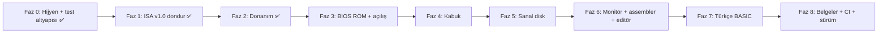

# TÜRK-8 → Gerçek 8-Bit PC: Geliştirme Planı

Hedef: `./turk8` yazınca makine **kendi ROM'undan açılsın**, ekranda imleç beklesin; programlar sanal diskten yüklensin, makinenin içinde yazılabilsin (monitör, assembler, BASIC), ses ve gerçek kesme olsun. Her faz sonunda: **uygula → test et → commit → uzak repoya push** (`origin: github.com/Yukselcsgn/TURK-8`).

> [!IMPORTANT]
> **Faz 1 işlemcinin son halidir (ISA v1.0 dondurulur).** Faz 1 tamamlandıktan sonra işlemci komut setine (hata düzeltmeleri dışında) dokunulmayacaktır.

---

## 1. Mevcut komut setinin incelemesi (bulunan sorunlar)

| # | Sorun | Etkisi |
| :-- | :-- | :-- |
| 1 | `BÜYÜKSE` / `KÜÇÜKSE` yalnızca **Negatif** bayrağına bakıyor | İşaretsiz karşılaştırmada yanlış (ör. 200 ile 10) — **gerçek hata**. Carry tabanlı yapılacak |
| 2 | Yığına yalnızca `T` itilebiliyor (`X`, `Y` yok) | Alt programlar yazmaçları koruyamıyor |
| 3 | `Y` ile indeksli yükleme/saklama yok; `X`/`Y`'ye bellekten yükleme yok | Çift döngü, tablo işleri zorlaşıyor |
| 4 | Taşma (`T`) bayrağı tanımlı ama **hiç ayarlanmıyor** | Ölü bayrak |
| 5 | Bellekte doğrudan artır/azalt yok | Skor/sayaç için 3 komut gerekiyor |
| 6 | `X`/`Y` karşılaştırması eksik (`Y` yok), belleğe karşılaştırma yok | Gereksiz yazmaç kopyalama |
| 7 | Çıkarmada borçlu çıkarma (`SBC`), döndürme (`ROL`/`ROR`), bit sınama yok | 16 bit aritmetik ve bit işleri yapılamıyor |
| 8 | Dolaylı atlama/çağırma yok | BIOS servis tablosu ve atlama tabloları kurulamıyor |
| 9 | Yazılım kesmesi (sistem çağrısı) yok | Gerçek bir BIOS servisi mümkün değil |
| 10 | Bekleme komutu yok; emülatör boşta bile %100 CPU yakıyor | Pil/ısı, oyun senkronu |
| 11 | **Derleyici komut boyutunu "tahminle" buluyor** (`"VE" in satır` gibi alt dize kontrolleri) | Kırılgan; yeni komutlarla bozulur → tablo tabanlı yeniden yazıldı (Faz 0) |

---

## 2. ISA v1.0 (mevcut 48 komut + 37 yeni = 85, 256 slotun 1/3'ü)

### A) Eksik klasikler (diğer işlemcilerde de var)
| Opkod | Söz dizimi | Açıklama |
| :-- | :-- | :-- |
| `0x20` | `[adres] X YÜKLE` | Bellekten X'e |
| `0x21` | `[adres] Y YÜKLE` | Bellekten Y'ye |
| `0x22` | `[adres + Y] T YÜKLE` | Y indeksli okuma |
| `0x23` | `T [adres + Y] SAKLA` | Y indeksli yazma |
| `0x24` | `[[işaretçi] + Y] T YÜKLE` | Dolaylı + Y (kelime/tampon gezme) |
| `0x25` | `T [[işaretçi] + Y] SAKLA` | Dolaylı + Y yazma |
| `0x26` / `0x27` | `YG T AKTAR` / `T YG AKTAR` | Yığın göstergesi aktarımı |
| `0x3D` | `<n> Y KARŞILAŞTIR` | Y ile kıyas |
| `0x3E` | `[adres] KARŞILAŞTIR` | T ile bellek kıyası |
| `0x3F` | `<n> BORÇLA ÇIKAR` | `T = T - n - borç` (SBC, 16 bit çıkarma) |
| `0x40` / `0x41` | `ELDE KUR` / `ELDE TEMİZLE` | Elde bayrağını elle ayarla |
| `0x42` / `0x43` | `[adres] ARTIR` / `[adres] AZALT` | Bellekte doğrudan ±1 |
| `0x56` / `0x57` | `T SOLA DÖNDÜR` / `T SAĞA DÖNDÜR` | Elde üzerinden döndürme (ROL/ROR) |
| `0x58` | `<maske> BİT SINA` | `T & maske` sonucunu yalnızca bayraklara yazar |
| `0x59` / `0x5A` | `[adres] VE` / `[adres] VEYA` | Bellekle mantık işlemi |
| `0x76` | `<hedef> ELDE YOKSA ATLA` | Elde = 0 ise |
| `0x77` / `0x78` | `<hedef> NEGATİFSE ATLA` / `POZİTİFSE ATLA` | N bayrağına göre |
| `0x79` | `<hedef> TAŞMA VARSA ATLA` | Taşma bayrağı gerçekten çalışacak |
| `0x7A` | `<hedef> KÜÇÜK VEYA EŞİTSE ATLA` | Eksik karşılaştırma dalı |
| `0x7B` / `0x7C` | `[adres] ATLA` / `[adres] ÇAĞIR` | Dolaylı atlama/çağırma (BIOS tablosu) |
| `0x97`–`0x9A` | `X İT` `X ÇEK` `Y İT` `Y ÇEK` | Yazmaç koruma |
| — | *(düzeltme)* `BÜYÜKSE`/`KÜÇÜKSE` | Carry tabanlı, işaretsiz doğru; `BÜYÜK VEYA EŞİTSE` = `ELDE VARSA` takma adı |

### B) Gerçek bir PC için gerekenler
| Opkod | Söz dizimi | Açıklama |
| :-- | :-- | :-- |
| `0x05` | `<n> SİSTEM` | **Yazılım kesmesi / BIOS servis çağrısı**: `n` numaralı servise gider, `KESMEDEN DÖN` ile döner |
| `0x06` | `KARE BEKLE` | İşlemciyi bir sonraki 50 Hz tike kadar uyutur → oyun senkronu + emülatör CPU yakmaz |

### C) Bize özgü, başka PC'de olmayan komutlar
| Opkod | Söz dizimi | Açıklama |
| :-- | :-- | :-- |
| `0x07` | `RASTGELE` | `T` = donanım rastgele sayı (oyunlar için) |
| `0x44` | `T RAKAMLARA AYIR` | `T` (0-255) → `Y`=yüzler, `X`=onlar, `T`=birler, **ASCII rakam olarak**. Skor/sayı yazdırmak 40 satırdan 1 komuta iner |
| `0x28` | `KOPYALA` | Blok kopyalama: kaynak `[0x00]`, hedef `[0x02]`, uzunluk `[0x04]` (sıfır sayfa "blok yazmaçları") — ekran kaydırma, program yükleme |
| `0x29` | `DOLDUR` | `T` değeriyle hedef `[0x02]`'den uzunluk `[0x04]` bayt doldur — ekran silme tek komut |

> [!NOTE]
> `T RAKAMLARA AYIR`, `KARE BEKLE`, `KOPYALA`, `DOLDUR` bilinçli tercihtir: BASIC, kabuk ve oyunlar bunları sürekli kullanacak; hepsi kod boyutunu ve hatayı belirgin azaltır.

---

## 3. Fazlar

Her faz **test geçmeden commit edilmez**. Test altyapısı Faz 0'da kurulur: `0xA0FF` "test sonuç" portu + `./turk8 --test x.rom` (başsız çalışır, çıkış kodu 0/1) + `make test`.

### Faz 0 — Hijyen ve test altyapısı (Tamamlandı ✅)
- [x] Repoda **`.o` dosyaları ve `turk8` ikilisi takip ediliyor** → `.gitignore` ekle, `git rm --cached` ile çıkar.
- [x] Bekleyen Pong/dolaylı adresleme/zamanlayıcı değişikliklerini commit'le.
- [x] Derleyiciyi **tablo tabanlı** yeniden yaz (`araclar/isa.py` tek kaynak; boyut tahmini hilesi kalkar). Mevcut tüm `.asm` programları aynı baytları üretmeli (regresyon testi).
- [x] `tests/` + `make test` iskeleti (`tests/yardimci.py`, `tests/test_faz0.py`). Doğrulama: mevcut programların çıktıları aynı.

### Faz 1 — ISA v1.0 (son işlemci değişikliği — Tamamlandı ✅)
- [x] Bölüm 2'deki komutlar (toplam 91 komut) + `BÜYÜKSE`/`KÜÇÜKSE` düzeltmesi + taşma bayrağı.
- [x] **Her komut için en az bir test** (`tests/test_faz1_isa.py`, bayraklar dahil, sınır değerleri 0/127/128/255).
- [x] Ayıklayıcı (disassembler) ve komut tablosu güncellendi. Doğrulama: tüm testler yeşil.

### Faz 2 — Donanım (Tamamlandı ✅)
- [x] **Gerçek 50 Hz zamanlayıcı kesmesi** (`0xFFFE` / RAM `0x00FE` vektörü), `KARE BEKLE` ile uyum (`islemci_kare_bildir`).
- [x] Klavye: tek bayt yerine **16 baytlık FIFO tampon** ve taşma bayrağı (`klavye_tasti`).
- [x] **Ses portu** (`0xA004` frekans, `0xA005` süre). Varsayılan terminal zili (`BEL`), test kipinde sessiz mod.
- [x] Rastgele sayı üreteci portu (`0xA006`), disk denetleyici port alanı (`0xA010–0xA017`) ayrıldı.
- [x] Doğrulama: kesme, FIFO taşması, RNG dağılımı testleri (`tests/test_faz2_donanim.py`); Pong (`programlar/pong.asm`) `KARE BEKLE`, `T RAKAMLARA AYIR` ve ses portu ile güncellendi.

### Faz 3 — BIOS ROM ve açılış
- [ ] `roms/bios.asm` → `0xC000`: sıfırlama vektörü, bellek testi, açılış başlığı ("TÜRK-8 ... 31 KB SERBEST"), imleç.
- [ ] **BIOS servisleri** (`<n> SİSTEM`): harf yaz, satır oku, tuş bekle, ekran temizle, ekran kaydır, ses çal, süre oku.
- [ ] `./turk8` argümansız → doğrudan açılış. Derleyiciye **çok bölümlü `.BAŞLANGIÇ`** desteği (ROM + vektörler).
- [ ] Doğrulama: başsız açılış testi (ekran içeriğini VRAM'den kontrol et).

### Faz 4 — Kabuk (ROM içinde)
- [ ] Satır düzenleme (Backspace, Enter), komutlar: `YARDIM`, `TEMİZLE`, `BİLGİ`, `BELLEK <adr>`, `ÇALIŞTIR <adr>`, `SÜRE`.
- [ ] Doğrulama: klavye girdisini besleyip çıktıyı VRAM'den doğrulayan betikli testler.

### Faz 5 — Sanal disk
- [ ] `disk.t8` imajı: 256 baytlık sektörler, 16 girişli basit dizin. Emülatörde disk denetleyici.
- [ ] `araclar/disk.py`: imaj oluştur, `.rom` ekle/çıkar. Kabukta `LİSTE`, `YÜKLE`, `KAYDET`, `SİL`, `ÇALIŞTIR <ad>`.
- [ ] Pong, merhaba vb. diskten açılır. Doğrulama: kaydet → yeniden başlat → yükle döngüsü.

### Faz 6 — Makinenin içinde program yazma
- [ ] **6a** Monitör (Woz tarzı): `0200: A9 05 ...` ile bayt girişi, bellek dökümü, çalıştır.
- [ ] **6b** Satır assembler: `A 0200` sonra satır satır Türkçe komut yaz.
- [ ] **6c** Tam ekran editör + etiketli assembler (diske kaydeder).
> [!WARNING]
> Assembler'ı 64 KB içinde, TÜRK-8 assembly'siyle yazmak en zor iş. 6c'de komut alt kümesiyle (tüm komutlar, ama sınırlı etiket/ifade) başlayıp genişletmeyi öneriyorum; gerekirse 6a/6b'de durup 6c'yi ayrı ele alırız.

### Faz 7 — Türkçe BASIC
- [ ] `SATIR 10 YAZ "MERHABA"`, `GİT`, `EĞER … İSE`, `DÖNGÜ`, `GİRDİ`, `ÇALIŞTIR`, `LİSTELE`, `YENİ`, `KAYDET/YÜKLE`, `RASTGELE`.
- [ ] ROM 16 KB; BIOS+kabuk ~4-5 KB olacağından BASIC yorumlayıcısı **diskten yüklenen bir program** olur (`BASIC` komutu). Program alanı ~20 KB kalır.
- [ ] Doğrulama: örnek BASIC programları (sayı tahmin, döngü) başsız testle.

### Faz 8 — Belgeler, CI, sürüm
- [ ] 4 `.md` dosyası (README/OKUBENI/USER_MANUAL/KULLANIM_KILAVUZU) her faz sonunda güncellenir; ISA tablosu otomatik üretilir (elle senkron hatası olmasın).
- [ ] GitHub Actions: ubuntu + macOS + windows derleme ve `make test`.
- [ ] Etiketli sürümler: `v0.2` (Faz 1), `v0.5` (Faz 4), `v1.0` (Faz 7).

---

## 4. Çalışma düzeni ve riskler
- Her faz: küçük commit'ler → faz sonunda `make test` yeşilse push (`main`).
- En riskli parçalar: dahili assembler (Faz 6c) ve BASIC (Faz 7); bunlar ROM içinde assembly ile yazıldığı için en uzun işler.
- Hata ayıklama yükü büyük: bu yüzden test altyapısı en başta (Faz 0).
- Faz 1'den sonra işlemci değişmez; eksik çıkarsa tek istisna "hata düzeltmesi" olur.

